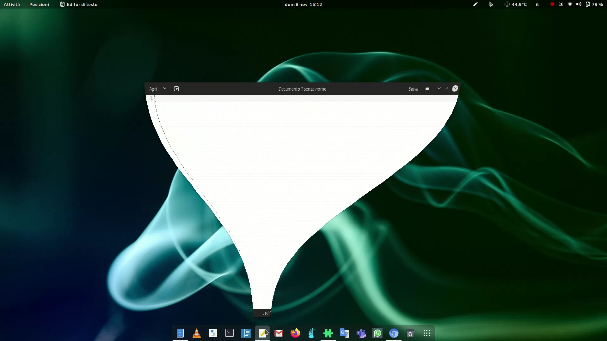

# Compiz alike Magic lamp effect for GNOME 45-50

[](https://extensions.gnome.org/extension/3740/compiz-alike-magic-lamp-effect/)

## Installation

### From GNOME Shell Extensions
You can install this extension by visiting [the GNOME Shell Extensions page](https://extensions.gnome.org/extension/3740/compiz-alike-magic-lamp-effect/).

[](https://extensions.gnome.org/extension/3740/compiz-alike-magic-lamp-effect/)

### Manual Installation (Development)
If you want to install the latest version from source, you can use the included installation script:

1. Clone this repository.
2. Run the installation script:
   ```bash
   bash install.sh
   ```
3. Restart GNOME Shell (X11: `Alt+F2` then `r`, Wayland: Log out and log in).
4. Enable the extension using **Extensions** or **Extension Manager**.

## Screen sharing

The animation also shows up in screen sharing, screen recording and screenshots. Those often repaint the screen separately from the display, and that repaint clears no depth buffer, so without care the deformed window is left out and a shared screen jumps straight from "window there" to "window gone". The extension clears the depth for such repaints only; what the display shows is untouched.

To check it, `tests/headless-screencast.sh` starts a throwaway headless GNOME Shell with its own PipeWire (everything under a fresh `/tmp` folder, the real screen is never captured), installs the extension from this folder, minimises and restores a test window and records it through mutter's screen cast. It fails unless every animation reaches the stream frame by frame:

```bash
tests/headless-screencast.sh --buffers shm      # memory buffers (repainted for the stream)
tests/headless-screencast.sh --buffers dmabuf   # GPU buffers (copied from the screen)
```

It needs `gnome-shell`, `pipewire`, `wireplumber`, `gjs` with GTK 4, `python3-gi` and the GStreamer PipeWire and OpenGL plugins.
